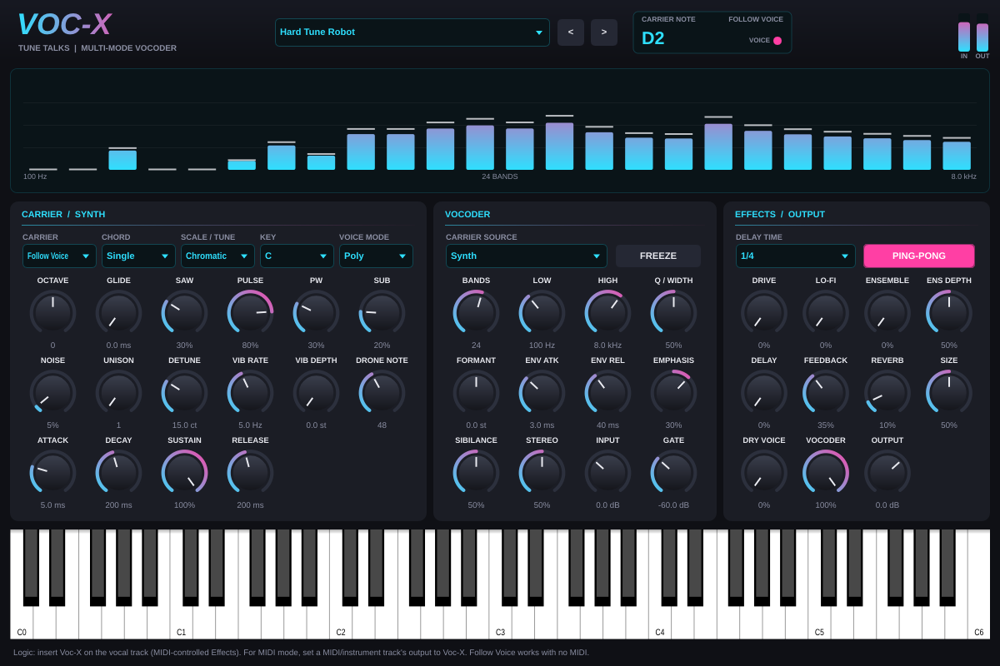

# Voc-X by Tune Talks: vocoder multi-modo per Logic Pro (AU / VST3)

Voc-X trasforma la voce in vocoder robotico, cori, talkbox, hard-tune, pad e mostri.
Ha un synth carrier interno, effetti integrati e 19 preset di fabbrica.
**Funziona anche senza MIDI:** in modalità *Follow Voice* il synth segue l'intonazione di chi canta.

## Installazione
1. Scarica **`VocX-x.y.z-macOS.pkg`** da [Releases](https://github.com/andreagrasselliatcg-art/voc-x/releases/latest).
2. Fai **tasto destro → Apri** e segui l'installazione (Apple Silicon + Intel, AU + VST3).
3. In Logic, sulla traccia della voce: slot **Audio FX → MIDI-controlled Effects → Tune Talks → Voc-X**.

## Le tre modalità del carrier
| Modalità | Come si usa |
|---|---|
| **Follow Voice** (default) | Nessun MIDI. Il synth segue la tua voce. Con **Scale/Tune** su *Chromatic* hai l'effetto hard-tune robotico; su *Major/Minor* + **Key** l'intonazione si aggancia alla tonalità. Con **Chord** aggiungi armonie automatiche (ottave, power chord, maggiore, minore, 7e, sus4, quinte, choir). |
| **MIDI** | Il classico vocoder. Crea una traccia *External MIDI* (o Software Instrument), imposta come uscita/destinazione MIDI **Voc-X** sulla traccia voce e suona gli accordi. Puoi suonare anche con la tastiera a schermo. *Voice Mode*: Poly, Mono o Legato (con Glide). |
| **Drone** | Nota o accordo fisso (**Drone Note** + Chord). Si attiva quando canti. |

**Carrier Source → Sidechain**: usa come carrier un'altra traccia di Logic, per esempio il tuo synth o un pad.
Selezionala nel menu *Side Chain* in alto nella finestra del plugin.

## Funzioni
**Synth carrier:** Saw, Pulse con PW, Sub, Noise; Unison fino a 7 voci con Detune; ADSR; Vibrato;
Octave ±2; Glide; polifonia fino a 16 voci; chord memory.

**Vocoder:** da 4 a 40 bande, range Low/High, **Q/Width**, **Formant shift** ±12 semitoni (voce da mostro o da alieno),
**Env Attack/Release** (da articolato a pad), **Emphasis** (scuro/brillante), **Sibilance** (le "s" e le "t"
restano intelligibili), **Stereo** (bande alternate L/R), **Input gain**, **Gate** e **Freeze** (congela la vocale).

**Effetti:** Drive, Lo-Fi (bitcrush e downsample), **Ensemble** a tre fasi stile string machine,
**Delay** sincronizzato al tempo di Logic (anche ping-pong), **Reverb**, Dry Voice, livello del vocoder, Output.

**Display:** analizzatore delle bande in tempo reale, nota del carrier, LED voce, meter IN/OUT.

## Preset
Init Auto · Classic MIDI Vocoder · Robot Funk · Hard Tune Robot · Auto Chord Major · Dark Minor Choir ·
Harmony Stack 5ths · Vocal Thickener · 70s Machine · String Choir Ensemble · Talkbox · Whisper ·
Deep Monster · Alien Chipmunk · Lo-Fi Radio · Space Echo Pad · Power Chord Drone · Sidechain Carrier · Frozen Choir

I preset compaiono anche nel menu preset di Logic. Le tue modifiche si salvano nel progetto e
con "Save as..." di Logic.

## Compilare da sorgente
A ogni push GitHub Actions compila, valida con `auval` e pubblica il `.pkg` nelle Releases.
In locale: `cmake -B build -DCMAKE_BUILD_TYPE=Release && cmake --build build --target VocX_AU VocX_VST3`.
Test: `-DVX_BUILD_TESTS=ON`, poi esegui `VocXTests`. Coprono livelli di tutti i preset, pitch tracking, hard-tune, assenza di
rientri del carrier, CPU e salvataggio dello stato.

Costruito con JUCE 8.
